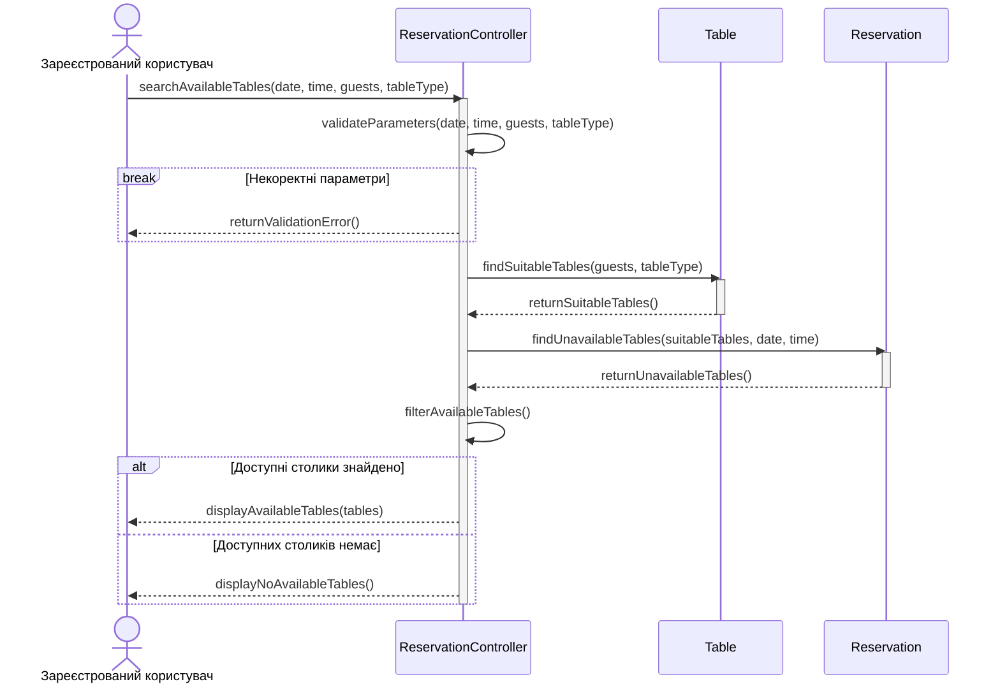

# Сценарій 1. Перегляд доступних столиків перед бронюванням

**Мета:** надати зареєстрованому користувачу список столиків, доступних для бронювання на вибрану дату, час і кількість гостей.

**Учасники:**

- Зареєстрований користувач - задає параметри пошуку та переглядає результат.
- ReservationController - обробляє запит, перевіряє параметри та координує пошук.
- Table - надає інформацію про столики та їхню місткість.
- Reservation - допомагає визначити, які столики вже заброньовані на вибраний час.

**Послідовність дій:**

1. Зареєстрований користувач надсилає запит на пошук доступних столиків, указуючи дату, час, кількість гостей і бажаний тип столика.
2. ReservationController перевіряє коректність отриманих параметрів.
3. Якщо параметри некоректні, система повертає повідомлення про помилку, після чого сценарій завершується.
4. Якщо параметри коректні, ReservationController запитує в Table столики, які відповідають вибраному типу та мають достатню місткість для зазначеної кількості гостей.
5. Table повертає список столиків, що відповідають заданим критеріям.
6. ReservationController звертається до Reservation, щоб отримати інформацію про бронювання відповідних столиків на вибрані дату й час.
7. Reservation повертає інформацію про наявні бронювання.
8. ReservationController визначає доступні столики та повертає результат користувачу.
9. Якщо доступних столиків немає, система повідомяє про це користувача та пропонує змінити параметри пошуку.

Sequence-діаграма:

