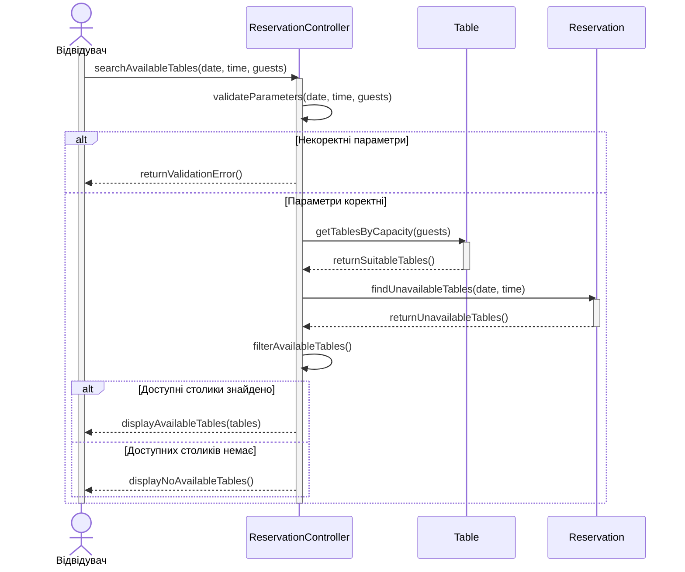

# Сценарій 1. Перегляд доступних столиків перед бронюванням

**Мета:** надати відвідувачу список столиків, доступних для бронювання на вибрану дату, час і кількість гостей.

**Учасники:**

- Відвідувач - задає параметри пошуку та переглядає результат.

- ReservationController - обробляє запит, перевіряє параметри та координує пошук.

- Table - надає інформацію про столики та їхню місткість.

- Reservation - допомагає визначити, які столики вже заброньовані на вибраний час.

**Послідовність дій:**

1. Користувач надсилає запит на пошук доступних столиків, указуючи дату, час і кількість гостей.

2. ReservationController перевіряє коректність отриманих параметрів.

3. Якщо параметри некоректні, система повертає повідомлення про помилку.

4. Якщо параметри коректні, ReservationController запитує в Table столики, місткість яких достатня для зазначеної кількості гостей.

5. Table повертає список відповідних столиків.

6. ReservationController звертається до Reservation, щоб отримати інформацію про бронювання столиків на вибрані дату й час.

7. Reservation повертає інформацію про наявні бронювання.

8. ReservationController визначає доступні столики та повертає результат користувачу.

9. Якщо доступних столиків немає, система повідомяє про це користувача та пропонує змінити параметри пошуку.

Sequence-діаграма:

