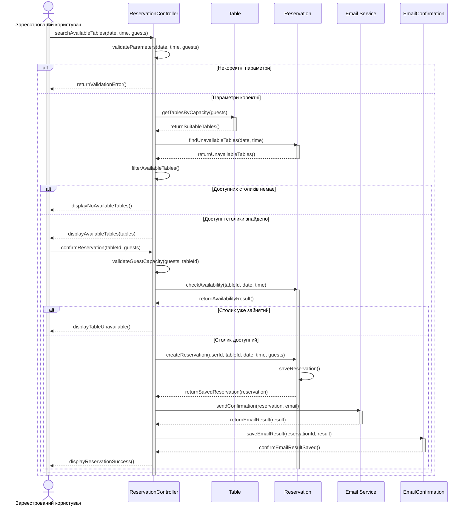

# Сценарій 2. Успішне бронювання столика

**Мета:** створити бронювання для зареєстрованого користувача та ініціювати надсилання листа-підтвердження.

**Учасники:**

- Зареєстрований користувач - обирає столик, указує параметри та підтверджує бронювання.

- ReservationController - обробляє запит, перевіряє параметри та координує створення бронювання.

- Table - надає інформацію про столики.

- Reservation - перевіряє наявні бронювання та зберігає нове бронювання.

- Email Service - надсилає лист-підтвердження користувачу.

- EmailConfirmation - зберігає результат надсилання листа.

**Послідовність дій:**

1. Користувач надсилає до ReservationController запит на пошук столиків, указуючи дату, час і кількість людей.

2. ReservationCOntroller перевіряє коректність параметрів пошуку.

3. Якщо параметри коректні, ReservationController надсилає до Table запит на отримання столиків із достатньою місткістю.

4. Table повертає список столиків, які підходять за кількістю гостей.

5. ReservationController надсилає запит до Reservation на отримання бронювань на вибрані дату й час.

6. Reservation повертає список уже забрьоньованих столиків.

7. ReservationController відбирає доступні столики та показує їх користувачу.

8. Користувач обирає столик зі списку та надсилає до ReservationController запит на підтвердження бронювання.

9. ReservationController повторно перевіряє доступність вибраного столика через Reservation.

10. Reservation повертає результат перевірки. Якщо столик доступний, ReservationСontroller надсилає запит на створення бронювання.

11. Reservation зберігає бронювання в базі даних і повертає підтвердження успішного збереження.

12. ReservationController передає до Email Service запит на надсилання листа-підтвердження з даними бронювання та електронною адресою користувача.

13. Email Service повертає результат надсилання листа.

14. Система записує результат надсилання листа.

15. ReservationController повідомляє користувача про успішне створення бронювання.

Sequence-діаграма:

