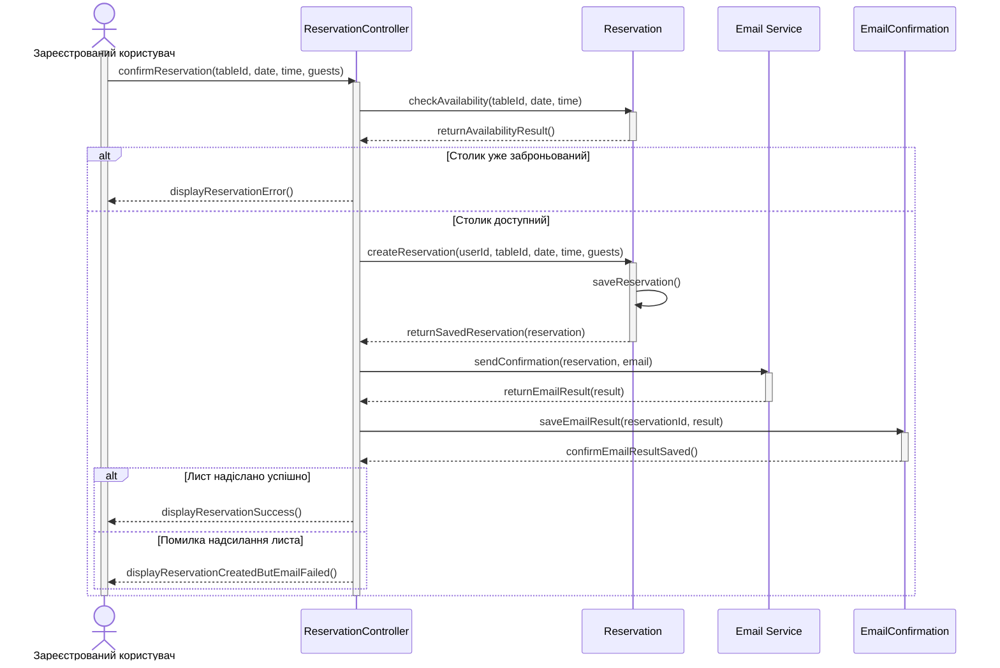

# Сценарій 2. Успішне бронювання столика

**Мета:** створити бронювання для зареєстрованого користувача та ініціювати надсилання листа-підтвердження.

**Учасники:**

- Зареєстрований користувач - підтверджує бронювання обраного столика.
- ReservationController - отримує запит, координує перевірку доступності столика, створення бронювання та надсилання листа-підтвердження.
- Reservation - перевіряє наявні бронювання та зберігає нове бронювання.
- Email Service - надсилає лист-підтвердження користувачу.
- EmailConfirmation - зберігає результат надсилання листа.

**Послідовність дій:**

1. Користувач підтверджує бронювання.
2. ReservationController отримує запит на створення бронювання.
3. ReservationController надсилає до Reservation запит на повторну перевірку доступності обраного столика на вибрані дату й час.
4. Reservation повертає результат перевірки доступності.
5. Якщо столик уже заброньований іншим користувачем, ReservationController повідомляє про це користувача. Бронювання не створюється, і користувач може повернутися до пошуку та обрати інший столик.
6. Якщо столик доступний, ReservationController надсилає до Reservation запит на створення бронювання.
7. Reservation створює запис бронювання в базі даних і повертає ReservationController підтвердження успішного збереження.
8. ReservationController передає Email Service дані бронювання та електронну адресу користувача для надсилання листа-підтвердження.
9. Email Service повертає результат надсилання листа до ReservationController.
10. ReservationController передає результат до EmailConfirmation для збереження.
11. Якщо лист надіслано успішно, ReservationController повідомляє користувача про створення бронювання та надсилання підтвердження.
12. Якщо лист не вдалося надіслати, ReservationController повідомляє користувача, що бронювання успішно створено, але лист-підтвердження не надіслано. Бронювання залишається чинним.

Sequence-діаграма:

