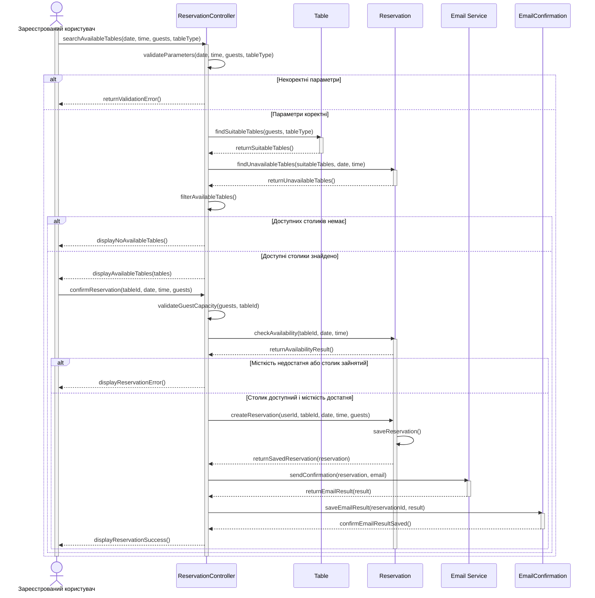

# Сценарій 2. Успішне бронювання столика

**Мета:** створити бронювання для зареєстрованого користувача та ініціювати надсилання листа-підтвердження.

**Учасники:**

- Зареєстрований користувач - обирає дату, час, кількість гостей і тип столика, обирає доступний столик та підтверджує бронювання.
- ReservationController - обробляє запит, перевіряє параметри та координує створення бронювання.
- Table - надає інформацію про столики, їхню місткість і тип.
- Reservation - перевіряє наявні бронювання та зберігає нове бронювання.
- Email Service - надсилає лист-підтвердження користувачу.
- EmailConfirmation - зберігає результат надсилання листа.

**Послідовність дій:**

1. Користувач надсилає до ReservationController запит на пошук столиків, указуючи дату, часкількість гостей і бажаний тип столика.
2. ReservationCOntroller перевіряє коректність параметрів пошуку.
3. Якщо параметри некоректні, система повертає повідомлення про помилку та пропонує виправити їх.
4. Якщо параметри коректні, ReservationController надсилає до Table запит на отримання столиків, які відповідають вибраному типу та мають достатню місткість для зазначеної кількості гостей.
5. Table повертає список столиків, які відповідають заданим критеріям.
6. ReservationController надсилає запит до Reservation на отримання інформації про бронювання на вибрані дату й час.
7. Reservation повертає інформацію про наявні бронювання.
8. ReservationController відбирає доступні столики та показує їх користувачу.
9. Якщо доступних столиків немає, система повідомляє про це користувача та пропонує змінити дату, час, кількість гостей або тип столика. Користувач може повторити пошук.
10. Якщо доступні столики є, ReservationController відображає їхній список користувачу.
11. Користувач обирає столик зі списку та надсилає до ReservationController запит на підтвердження бронювання.
12. ReservationController повторно перевіряє місткість вибраного столика та його доступність на вибрані дату й час.
13. ReservationController повертає результат перевірки. Якщо столик уже заброньований або його місткість недостатня, система повідомляє про це користувача, не створює бронювання та пропонує обрати інший столик або змінити кількість гостей.
14. Якщо столик доступний і його місткість достатня, ReservationController надсилає запит на створення бронювання.
15. Reservation зберігає бронювання в базі даних і повертає підтвердження успішного збереження.
16. ReservationController передає до Email Service запит на надсилання листа-підтвердження з даними бронювання та електронною адресою користувача.
17. Email Service повертає результат надсилання листа.
18. Система зберігає результат надсилання листа в EmailConfirmation.
19. Якщо лист надіслано успішно, ReservationController повідомляє користувача про створення бронювання та надсилання підтвердження. Якщо надсилання не вдалося, система зберігає інформацію про помилку та повідомляє користувача про те, що бронювання створено, але лист не надіслано. Бронювання залишається в базі даних.

Sequence-діаграма:

