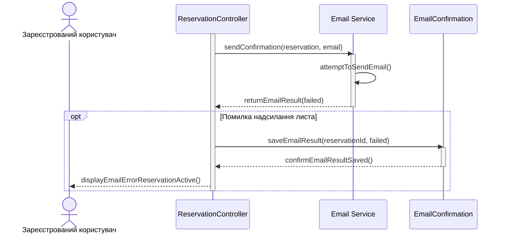

# Сценарій 3. Помилка надсилання листа-підтвердження

**Мета:** забезпечити збереження бронювання навіть у разі невдалого надсилання листа-підтвердження.

**Учасники:**

- Зареєстрований користувач - отримує повідомлення про результат створення бронювання та надсилання листа.
- ReservationController - координує надсилання листа та обробляє його результат.
- Email Service - намагається надіслати лист-підтвердження користувачу.
- EmailConfirmation - зберігає інформацію про результат надсилання листа.

**Передумови:** користувач успішно створив бронювання, яке вже збережене в базі даних.

**Послідовність дій:**

1. ReservationController передає Email Service дані створеного бронювання та електронну адресу користувача.
2. Email Service намагається надіслати лист-підтвердження.
3. Email Service отримує помилку під час надсилання листа.
4. Email Service повертає ReservationController інформацію про невдале надсилання.
5. ReservationController передає в EmailConfirmation результат невдалого надсилання листа.
6. EmailConfirmation зберігає результат надсилання зі статусом невдачі.
7. ReservationController повідомляє користувача про те, що бронювання створене, але лист-підтвердження не вдалося надіслати.
8. Створене бронювання залишається збереженим у базі даних і не скасовується через помилку надсилання листа.

**Результат:** бронювання збережене та залишається чинним, а інформація про помилку надсилання листа зафіксована в системі.

Sequence-діаграма:

